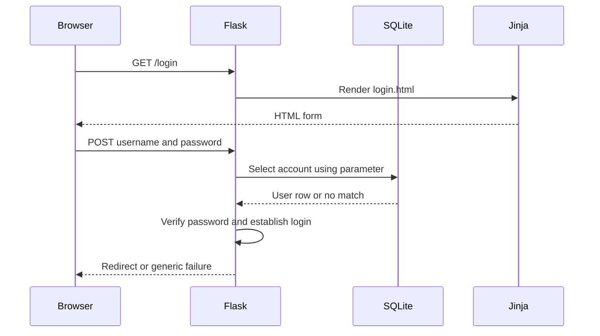

# Block 1 student guide: authentication and role permissions

Secure Authentication, Authorisation and Session Management · Level 6 · w/c 9 November 2026

**Duration:** 120 minutes, including a five-minute break. **Starting point:** the Block 1 starter repository. No Block 2 files are needed. You should recognise Python functions, conditions and dictionaries. Prior Flask/Jinja experience can be minimal.

## Scenario and outcomes

A college is prototyping a Student Project Portal. Students create accounts. Teaching staff use a staff workspace, while administrators see account information. The college wants you to implement an explicit access policy and explain why the server must enforce it.

By the end, you should be able to explain authentication versus authorisation; implement and test password registration and login; enforce role permissions; and justify an MFA recommendation and its limitations. These are formative lab tasks, not instructions for completing a summative assessment.

## Route through the block

| Minutes | Activity | Working arrangement |
|---|---|---|
| 0–10 | Read the scenario and introduction; discuss identity and permissions | Short tutor introduction, or independent reading |
| 10–25 | Exercise 1: access policy | Two pairs and one group of three, or solo |
| 25–45 | Exercise 2: trace the application | Same groups, rotate roles |
| 45–50 | Break | |
| 50–85 | Exercise 3: registration and login | Individual |
| 85–110 | Exercise 4: enforce roles and test denials | Individual |
| 110–120 | Evidence review and MFA evaluation | Individual |

In each group use a **driver** (operates the computer), **navigator** (reads the next step and checks its meaning), and **security reviewer** (predicts denied cases). Pairs combine the last two roles. Rotate between exercises and halfway through the longer exploration. Each person keeps their own evidence. Working alone, perform the same roles in sequence: predict, act, explain.

## Read before coding

Authentication establishes which account the requester controls. Authorisation decides whether that account may perform a specific action. A session carries the authenticated state between requests. These decisions are related but separate: a valid login must still fail an unauthorised request.

A password hash is a one-way verifier. A salt makes identical passwords produce different encoded hashes. A password-hashing algorithm also makes each guess expensive. Argon2id has memory and time costs. A general-purpose fast hash such as SHA-256 alone makes offline guesses cheap. The library manages salts and verification; you must not invent your own algorithm or compare freshly salted hashes for equality.

This lab uses 15–128 characters for newly registered passwords, permits spaces and normalises Unicode consistently. This is only part of a password policy: breached-password checking, rate limiting, recovery and MFA are outside the implemented core. NIST's current single-factor guidance provides useful context, but this small lab does not claim full compliance.

Block 1 already supplies CSRF protection and cookie settings so that the authentication exercise stays focused. Its ordinary Flask logout clears the browser's login state. Server-side revocation of a copied cookie is the distinct Block 2 task.

## Run this block in Codespaces

1. Accept **this block's** classroom50 assignment using the link or command your tutor supplies. Open your individual repository, not the tutor's template.
2. On GitHub choose **Code → Codespaces → Create codespace on main**. Wait for the container and its `postCreateCommand` to finish. The repository supplies a Python 3.14 container.
3. Open a terminal at the repository root, where `app.py` is visible. Run:

```bash
source .venv/bin/activate
python --version
python -m pytest -q tests/test_smoke.py
python -m flask --app app run --host 0.0.0.0 --port 5000
```

The version must begin `Python 3.14`. The smoke test should pass. Flask stays running in this terminal. Use a **second terminal**, with the virtual environment activated, for tests and other commands.

4. In **Ports**, open port **5000** in your browser. Keep its visibility **Private**. The forwarded browser address begins `https://` even though Flask listens over HTTP inside the container. Sign into GitHub if the private-port gateway asks you to.
5. Use the portal's **Log in** page after passing the GitHub gateway. These are separate logins. All demo passwords are `Learning-Portal-2026!` and are fictional:

| Username | Role | Meaning |
|---|---|---|
| `alice` | student | First learner |
| `bob` | student | Second learner |
| `sam` | staff | Teaching staff |
| `ada` | admin | Account administrator |

Do not use real student information or a real password. The starter intentionally has incomplete security. The completed app is a learning example, not a production deployment.

If setup did not complete, run `bash scripts/bootstrap.sh`, then activate `.venv`. To reset the fictional database, stop Flask with **Ctrl+C**, run `python -m flask --app app init-db`, then restart it. Reset deletes registrations, notes and server session records in this lab. It keeps your source files. Only reset when you intend to discard that lab data.

Flask is run without debug mode. After changing Python or templates, stop and restart it, then refresh the page. Tests load code again on each run and need no Flask server.

For local catch-up outside Codespaces, install Python 3.14, open a terminal at the repository root and run `bash scripts/bootstrap.sh`. Then use the commands above and visit `http://127.0.0.1:5000`. The completed configuration permits a non-Secure cookie only in this local HTTP lab. Cookie-security evidence must use the HTTPS Codespaces URL. If you move between environments, clear the portal cookie and log in again.

**Starter behaviour:** the home and login pages render. Registration reports an unfinished task and correct passwords cannot log in until Exercise 3 is completed. Role checks are intentionally incomplete once login works. A failing security suite at this stage is expected. `hash_demo.py` already works independently of those tasks.

## How the scaffold is organised

| File | Purpose | Your work |
|---|---|---|
| `app.py` | App settings, database helpers, user object, security helpers and routes, in that order | Only the labelled tasks |
| `schema.sql` | Creates small SQLite tables with understandable column names | Read it; no schema changes required |
| `templates/base.html` | Shared heading, navigation, messages and content block | Read its Jinja conditions |
| `templates/login.html` | GET form and POST field names | Trace the fields into the route |
| `templates/account.html` | Uses `current_user` to show account details | Inspect the template variables |
| `static/style.css` | Minimal presentation | No CSS work required |
| `tests/` | Fresh test database, small request helpers, security tests | Run tests and complete one test |
| `instance/` | Generated database and secret key | Never commit this folder |
| `.devcontainer/` | Python 3.14 Codespaces configuration | Supplied |
| `requirements.txt` / `requirements-lock.txt` | Direct dependencies / exact tested dependency set | Setup installs the lock file |

A **route** is a Python function selected by a URL and HTTP method. `@app.get('/account')` attaches `/account` to `account()`. The decorators immediately above a function wrap it with additional checks. In `role_required`, `@login_required` checks authentication before the role comparison runs. `@wraps` retains the function name that Flask uses for routing.

`request.form` reads submitted fields by their HTML `name`, not by the visible label. `render_template('account.html', ...)` runs Jinja on the server and returns HTML. `{{ ... }}` prints a value, `` makes a template decision, and `` reuses the shared layout. Jinja escapes ordinary HTML-template values by default. Do not add `|safe` to student input.

`get_db()` opens SQLite once per request and stores the connection in Flask's request-local `g`. `sqlite3.Row` lets us use names such as `row['role']`. `fetchone()` returns one row or `None`; `fetchall()` returns a list. A tuple `(user_id,)` has a trailing comma because it contains one parameter. `?` placeholders bind values as data. `commit()` persists writes. `rollback()` cancels a failed transaction. The teardown function closes the connection even after a request error.

`User` adapts a database row for Flask-Login. `current_user` is the current request's user object; `UserMixin` supplies common authentication properties. The `user_loader` loads the user and current role from the database on later requests. There is no role dropdown whose value the server trusts.

Additional files: `templates/register.html` is the registration form. `hash_demo.py` demonstrates Argon2. `checkpoints/after-auth.py` lets you start Exercise 4 if you are catching up on that topic alone.

## Exercise 1: who should be allowed to do what? (15 minutes)

**Purpose:** turn the scenario into a policy before writing conditions. **Starting point:** this guide and `EVIDENCE.md`; no running code is required.

The agreed business rules are: anyone may request a student account; an authenticated user may see their own account; only staff use the staff area; only administrators use account administration. New accounts never self-select staff or administrator privileges. Administrator is a separate job function, not a universal superuser.

1. In `EVIDENCE.md`, complete the permissions matrix for an anonymous visitor, a student, a staff member and an administrator. Use “allow”, “login required” or “deny”. Include registration, own account, staff area and administration.
2. For each route, identify whether the decision needs authentication, authorisation, or both.
3. Explain the impact of a registration form containing `<input name="role" value="admin">` if the server trusts it. Predict what your finished server should do with that extra field.
4. Write one least-privilege justification for keeping administrator and staff permissions separate.
5. Compare a password plus a PIN with a password plus an authenticator app, and with a password plus a hardware security key. Identify which factors are independent. Consider phishing and account recovery.

**Solo route:** fill every column yourself. Then review each allowed action from the perspective of a student attempting to gain extra access. **Complete when:** the matrix is consistent, and two decisions include a reason rather than just an answer.

## Exercise 2: follow a request through Flask and Jinja (20 minutes)

**Purpose:** understand supplied code before adding security logic. **Starting point:** an untouched Block 1 starter. Complete the setup above. You do not need working login yet.



1. Open `app.py`. Find the five numbered sections. Match each section to the file-purpose table above.
2. Open the portal's `/login` page. The browser requests a page with **GET**. In `login()`, identify the final `render_template` call that handles this.
3. Open `templates/login.html`. Find `method="post"`, `name="username"`, `name="password"` and the hidden CSRF field. Follow those names into `request.form.get(...)` in Python.
4. Submit Alice's demo credentials. The starter returns “Invalid username or password.” Locate `verify_password()` and explain why the current placeholder rejects even a correct password. This is deliberate, not a setup failure.
5. Change the welcome sentence in `templates/index.html` to include a fictional team name. Restart Flask and refresh Home. Explain why the edit changed the HTML but did not change a permission.
6. In `base.html`, find `current_user.is_authenticated` and the role conditions. Find the corresponding `/staff` and `/admin` routes. A navigation condition only affects a link: predict what a direct URL request would bypass.
7. Read `get_db()`, the login `SELECT`, and `load_user()`. Write one sentence each explaining `?`, `fetchone()`, and the tuple `(user_id,)`.
8. Copy the diagram into `EVIDENCE.md` or refer to it by step. Annotate where untrusted credentials enter, where password verification belongs, and where a permission check is still needed after login.

**Solo route:** do all eight steps and record your predictions before observing the result. **Complete when:** your welcome change appears, and you can explain a GET, a POST and one database lookup.

## Exercise 3: registration and login (35 minutes)

**Purpose:** store a verifier and establish an authenticated session. **Starting point:** Block 1 starter after Exercise 2; only its welcome text need have changed. Work individually. Search for the task labels rather than relying on line numbers.

### A. Hash a password

1. Run `python hash_demo.py`. Observe two different encoded hashes for the same password and successful verification. The `$argon2id$` prefix identifies the algorithm; the string also encodes parameters and salt. Do not copy either hash into your implementation.
2. In `app.py`, replace the `raise NotImplementedError(...)` line inside **TASK B1-A** with:

```python
return ph.hash(password)
```

`ph` is the supplied `PasswordHasher` instance. Call `hash()` once when creating a password verifier. SQLite will store the returned string.

### B. Save the account safely

3. In `register()`, locate **TASK B1-C**. Replace the placeholder `return render_template(...), 501` with these two lines (keep the existing `db.commit()` underneath):

```python
db.execute("INSERT INTO users (username, password_hash, role) VALUES (?, ?, ?)",
           (username, password_hash, "student"))
```

The variables are already validated or computed above. The fixed role enforces the policy even if a forged POST contains `role=admin`. The `UNIQUE` database constraint and supplied exception handler handle duplicate usernames without an extra race-prone “check then insert” assumption.

4. Restart Flask. Register `charlie` with a fictional passphrase of at least 15 characters. Expect a redirect to login and an account-created message. Try `charlie` again: expect a username-unavailable message, status 409. Try a short password: browser validation may stop it; the supplied test also checks server validation directly.
5. Inspect only the account you created:

```bash
python -m flask --app app shell
```

At the Python prompt:

```python
from app import get_db
row = get_db().execute("SELECT username, password_hash, role FROM users WHERE username = ?", ("charlie",)).fetchone()
print(dict(row))
exit()
```

Explain why the hash is still sensitive despite not being the original password. Attackers could try guesses offline after a database leak.

### C. Verify and log in

6. Replace the placeholder in **TASK B1-B** with:

```python
try:
    return ph.verify(stored_hash, password)
except (VerificationError, InvalidHashError):
    return False
```

`verify()` uses the parameters and salt from the stored string. A wrong password raises an exception. The handler turns that into a failed login, not a server crash. Do not write `ph.hash(password) == stored_hash`.

7. Read the already supplied success path in `login()`: it can refresh an old hash, clears pre-login session data, calls `login_user(User(row), remember=False)`, then redirects to `/account`. Flask-Login handles authentication state. The route sends the same message and status for an unknown account and an incorrect password. A dummy hash reduces a simple timing difference, but does not prove all enumeration channels are closed.
8. Restart Flask. Log in successfully as `charlie` or `alice`; log out; try a wrong password; then try an unknown username. Record all four results. The login failure message must remain identical.
9. Run:

```bash
python -m pytest -q tests/test_auth.py
```

All seven authentication tests should pass. They also submit `role=admin` during registration and verify that the stored role remains `student`. The role tests still fail until Exercise 4.

**Complete when:** seven authentication tests pass, the database contains an Argon2id verifier, and you can explain the server-assigned role. **Solo route:** use the numbered steps and expected results above; no demonstration is required.

## Exercise 4: role permissions and regression tests (25 minutes)

**Purpose:** enforce permissions even when a user requests a hidden URL. **Starting point:** completed Exercise 3. If you are studying this exercise on its own, save your work and load the supplied checkpoint:

```bash
cp app.py app.before-checkpoint.txt
cp checkpoints/after-auth.py app.py
```

This checkpoint supplies authentication but deliberately leaves role enforcement incomplete. It does not change your templates. Restart Flask.

1. Log in as Alice. There is no staff navigation link. Enter `/staff` directly after your forwarded site's host name. The unfinished role check allows the staff page. Record expected denial and observed access.
2. In **TASK B1-D**, immediately before `return view(...)`, add:

```python
if current_user.role not in allowed_roles:
    abort(403)
```

Keep `@login_required` in the wrapper. Anonymous users must be redirected to login before a role check needs an authenticated user. The `*allowed_roles` argument allows a route to list multiple roles explicitly when policy requires it. This lab's staff route lists only `staff`.

3. Restart Flask. As Alice, request `/staff` and `/admin` directly. Expect 403 for both. As Sam, expect `/staff` to work and `/admin` to return 403. As Ada, expect `/admin` to work and `/staff` to return 403. Log out between accounts.
4. Compare those results with the navigation conditions in `base.html`. Explain why the template improves usability but the Python wrapper provides enforcement.
5. Run `python -m pytest -q tests/test_roles.py`. All seven role checks should pass.
6. Open `tests/test_student.py`. Remove the `@pytest.mark.skip(...)` line and complete the test body using this structure:

```python
login(client, "bob")                 # Arrange
result = get(client, "/admin")        # Act
assert result.status_code == 403     # Assert
```

A **fixture** supplies repeatable setup. The `client` fixture creates a temporary database for each test and a simulated browser. The helper logs in through the actual form, including a CSRF token. Arrange–act–assert separates setup, request and expected result. Tests should check outcomes allowed or denied by policy, not just whether a function was called.

7. Run `python -m pytest -q`. A completed Block 1 has 16 passing tests and no skipped student test. Save one denial case and one permitted case in your evidence.

**Complete when:** direct requests respect the matrix and your additional test passes. **Solo route:** use the checkpoint if necessary, then follow the same sequence.

## Final evaluation (10 minutes)

Write 120–180 words recommending MFA for the administrator. Identify factors, compare an authenticator code with a phishing-resistant security key, and explain a recovery/usability trade-off. Name a risk that MFA would leave: for example, an object-level permission failure or misuse of a session already stolen after authentication. MFA implementation is an optional later extension, not a requirement of this block.

Finish the evidence checklist and explain one remaining production requirement, such as login throttling, breached-password checking, secure recovery, monitoring or session revocation. Do not claim that a passing small test suite establishes production security.

## Troubleshooting and interpreting results

| Symptom | Check |
|---|---|
| `ModuleNotFoundError` | At the repository root, run `source .venv/bin/activate`. If `.venv` is missing, run the bootstrap script. |
| Python is not 3.14 | Rebuild the repository's dev container. Check `.devcontainer/devcontainer.json` is at the repository root. |
| `no such table` | Activate the environment and run `python -m flask --app app init-db`. This resets lab data. |
| Port 5000 already used | Stop the old Flask process with Ctrl+C. Run one application per port. |
| Your edit seems ignored | Stop and restart Flask; refresh. Check that you edited this block's `app.py`. |
| Login redirects repeatedly | Use the HTTPS forwarded URL in Codespaces. Clear the portal cookie. Check the server session has not expired. |
| `400` after adding CSRF | GET the page again for a fresh token. The hidden field must be **inside** the form, named `csrf_token`. Check every POST form, including logout. |
| `403` | Authenticated user lacks the route's required role. |
| `404` for an existing feedback record | Block 2 deliberately uses 404 for both missing and unauthorised records. |
| `302` in a test | A redirect. Read `response.headers['Location']` to distinguish successful login from a redirect back to login. |
| A security test fails in the starter | Often expected. Compare the failing case with the exercise's checkpoint. Do not change the expected result to make it pass. |
| A test appears to pass without your implementation | Check whether it is `skipped`. Remove the skip marker only after adding meaningful assertions. |

The Flask test client sends simulated requests without a network connection. It does not reproduce every browser cookie or SameSite rule. Tests check application behaviour and `Set-Cookie` headers; inspect the actual browser cookie separately.

## Evidence and submission

Keep your answers in `EVIDENCE.md`. Record expected behaviour, actual result, the relevant code location and why the change matters. Use fictional usernames and status codes. Do not include cookie values, session tokens or secret keys in screenshots or commits.

Before finishing, run `python -m pytest -q`, review `git diff`, then commit and push your code and evidence to your individual repository. Use the submission method on your classroom50 assignment page. If your class uses the installed student CLI, run `gh student submit` from the repository. A Git push alone may not submit a class configured to collect on submission tags. Verify the receipt/status in classroom50. Stop the Codespace when finished.

## Sources and further reading

See [REFERENCES.md](REFERENCES.md) for primary documentation, including Argon2, Flask-Login, OWASP and NIST. These sources support the design decisions; the college scenario and code are teaching examples.
